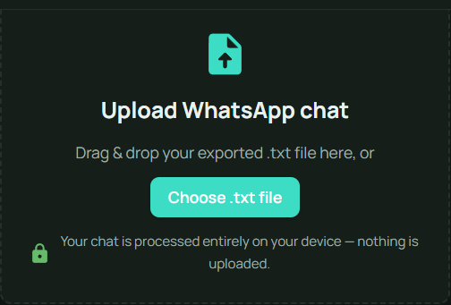
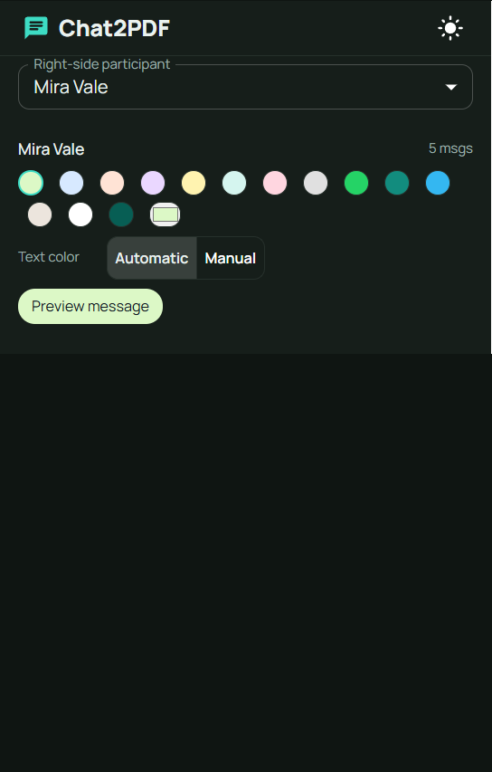
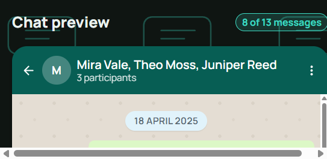
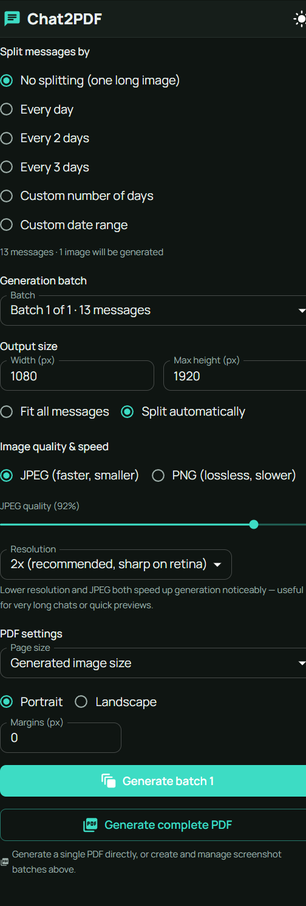

# Chat2PDF

Turn exported WhatsApp chats into screenshot-style images and PDFs. Parsing, editing, rendering, and export run locally in your browser; your chat is never uploaded.

## Screenshots

The screenshots use an original wizard-academy conversation in `docs/sample-chat.txt`.

<table>
   <tr>
      <th>Upload</th>
      <th>Customize</th>
   </tr>
   <tr>
      <td></td>
      <td></td>
   </tr>
   <tr>
      <th>Live preview</th>
      <th>Export settings</th>
   </tr>
   <tr>
      <td></td>
      <td></td>
   </tr>
</table>

## Features

- Drag-and-drop upload of WhatsApp `.txt` exports in Android and iOS formats
- Web Worker parsing with progress feedback for large files, multiline messages, system events, media placeholders, and Unicode names
- Participant alignment and color controls, chat header, background, typography, and message styling
- Live preview of a short chat sample, with a bounded scroll area that stays independent of export settings
- Light and dark themes; the preview has its own theme-aware chat-bubble texture
- Flexible date splitting, custom ranges, and automatic height-based pagination
- Generated page management with preview, delete, regenerate, and individual or batch image downloads
- High-resolution PNG output and combined PDFs with image-size, A4, Letter, or custom page settings
- A logo confirmation flow for returning to the upload page and discarding the current chat, edits, and generated pages
- Client-side processing: chat contents never leave the device

## Getting started

```bash
npm install
npm run dev
```

Then open the printed local URL (typically `http://localhost:5173`).

## Editing and exporting

1. Upload a WhatsApp `.txt` export.
2. Use the Customize panel to set participant alignment and colors, the chat header, background, and message typography. Presets are available at the top of the panel.
3. Check the live preview. It shows a limited sample and scrolls independently so it does not push the export section down the page.
4. In Export settings, choose how messages are split, image dimensions and quality, and PDF page settings.
5. Generate screenshot batches or a complete PDF. Review generated pages before downloading or rebuilding them.

Clicking the Chat2PDF logo while editing opens a confirmation. Confirming returns to upload and resets the current chat, customization settings, and generated output; cancelling keeps the session intact. On smaller screens, Preview, Customize, and Export are available as tabs.

The editor and export areas use solid theme surfaces. The chat-bubble texture is limited to the preview canvas and adapts to light and dark mode.

### Build for production

```bash
npm run build
npm run preview
```

### Run the parser test suite

```bash
npm test
```

## Sample conversation

Try the app with this original wizard-academy conversation: [`docs/sample-chat.txt`](docs/sample-chat.txt).

```text
18/04/2025, 08:04 - Mira Vale: The observatory chart is humming again.
18/04/2025, 08:06 - Theo Moss: Maybe it knows the comet is early.
18/04/2025, 08:08 - Mira Vale: Comets do not read timetables.
18/04/2025, 08:10 - Juniper Reed: This one left a silver trail over the greenhouse.
18/04/2025, 08:12 - Theo Moss: I found the trail in the west stairwell.
```

## How it works

```text
.txt file
   │  (Browser File API — never leaves the device)
   ▼
WhatsApp parser (src/parser)
   │  → ChatMessage[] + detected participants
   ▼
Chat settings (participants, colors, fonts, background, header…)
   ▼
Date-based splitting (src/utils/splitUtils.ts)
   │  → one group per day / N days / custom range
   ▼
Height-based pagination (src/pdf/imageGenerator.ts)
   │  → off-screen render + measure, binary-search split
   │    so no page exceeds the configured max height
   ▼
High-res capture (html-to-image) → PNG per page
   ▼
PDF assembly (src/pdf/pdfGenerator.ts, jsPDF) → downloadable PDF
```

Everything above runs in the browser. Parsing uses a Web Worker; rendering uses the DOM and Canvas. There is no backend or network request involving your chat contents.

## Project structure

```text
docs/
├── sample-chat.txt      # Original sample conversation for trying the app
└── screenshots/         # README screenshots of the app workflow
src/
├── components/         # Presentational + composed UI (chat renderer, settings panels, export UI)
├── parser/              # WhatsApp .txt parser + date utilities (fully unit-tested)
├── pdf/                 # Off-screen rendering, height pagination, and PDF assembly
├── state/               # Default settings, presets, and persisted UI preferences
├── types/               # Shared TypeScript types (chat, participant, settings)
├── utils/               # Color/contrast, file, formatting, and date-splitting helpers
├── App.tsx              # Application shell: upload flow + editor layout
└── main.tsx             # Entry point
```

## Performance

Two things were tuned specifically for large chats and fast exports:

1. **Parsing runs in a Web Worker** (`src/parser/parser.worker.ts`), not the main thread. A 30MB export is hundreds of thousands of lines, and running that parse loop synchronously on the UI thread is exactly what triggers the browser's "page unresponsive" warning. The worker receives the `File` directly (so the 30MB of text is never copied between threads — the worker reads its own bytes), parses it, and reports progress back so the upload screen can show a real percentage instead of freezing.
2. **Image/PDF generation avoids redundant work**:
   - Height-based pagination measures every message's position in a **single** off-screen render per date-group, rather than repeatedly mounting candidate slices to binary-search for a page break. For a group that splits into, say, 5 pages, that's 1 mount instead of dozens.
   - Multiple pages render **concurrently** (a small worker pool, not one-at-a-time), which noticeably speeds up multi-page exports.
   - Each rendered page records its own pixel dimensions at capture time, so building the final PDF never has to reload and re-decode every image just to read its width/height.
   - Capture format defaults to **JPEG** (configurable, with a quality slider) instead of PNG — chat screenshots are mostly solid colors and text, so JPEG encodes/decodes markedly faster and produces smaller files at a quality cost that's usually imperceptible. Lossless PNG stays available in Export settings.
   - Resolution (pixel ratio) is also configurable from Export settings — dropping to 1x or 1.5x is the single biggest lever if you want faster turnaround on a very long chat and don't need print-grade sharpness.

If you're still working with genuinely enormous chats (multi-hundred-thousand messages), the remaining cost is inherent: every page still has to go through a real browser layout + canvas capture, and that's fundamentally proportional to how many pages you're generating. Splitting into smaller date ranges via "Custom date range" before generating is the most effective way to keep any single generation run fast.

## Privacy and preferences

- Chat text is processed locally and is never written to `localStorage`.
- Theme and selected visual/output preferences are persisted in `localStorage` for convenience.
- Returning to the first page from the editor clears the loaded chat, customizations, and generated pages after confirmation.

## Notes and trade-offs

- **Built-in backgrounds** are generated with plain CSS gradients rather than shipping any WhatsApp-owned artwork, so the app has zero external/binary asset dependencies.
- **Height-based pagination** works by rendering candidate pages off-screen and measuring their real height, then binary-searching for the largest number of messages that still fit — this is correctness-first rather than the fastest possible approach; very large chats (tens of thousands of messages) will take some time to paginate since each candidate is a real DOM measurement.
- **"Download all images"** triggers sequential browser downloads (staggered to avoid the browser blocking them) rather than zipping them, to avoid adding a zip dependency; the PDF export is the recommended way to get everything in one file.
- **UI preferences** (theme, output size, font, bubble style) are persisted to `localStorage` for convenience. Uploaded chat text is never persisted.
